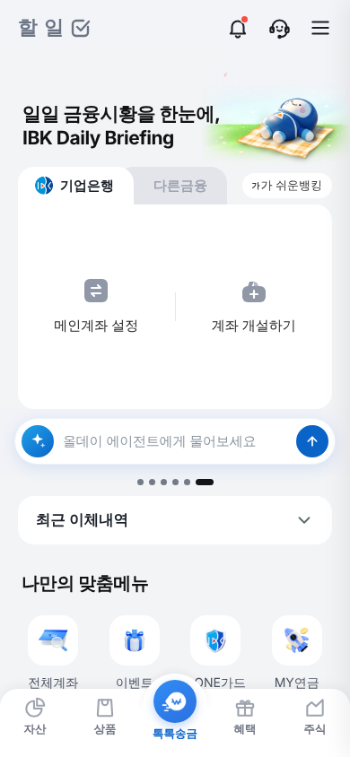
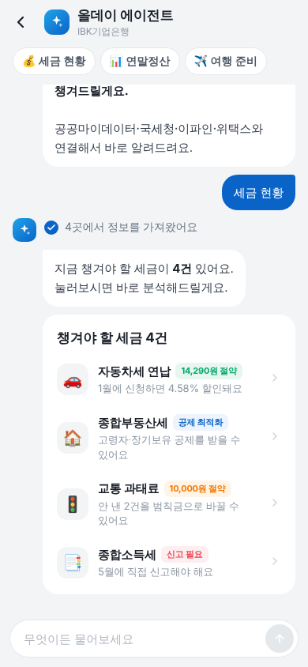
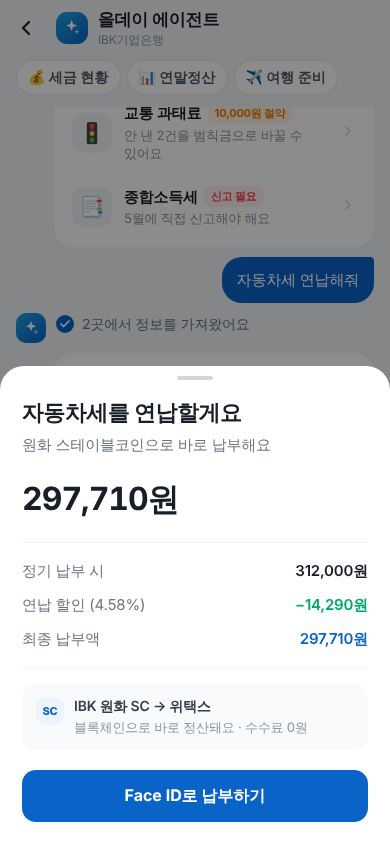
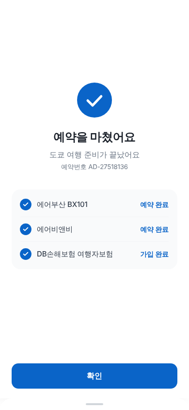
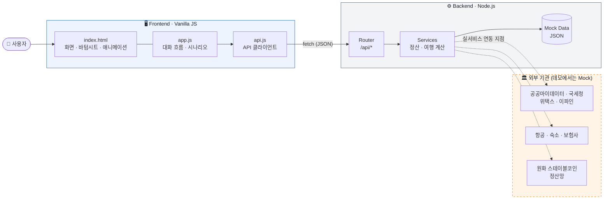
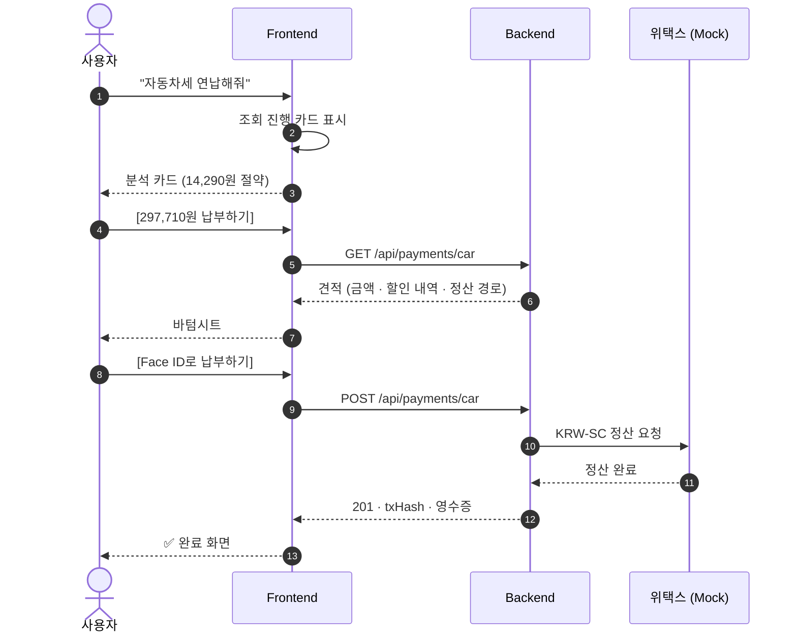
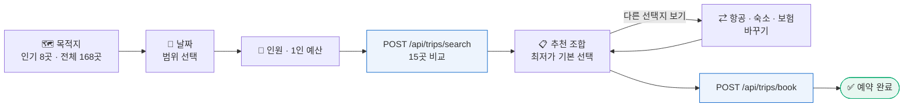

<div align="center">


# ✨ 올데이 에이전트 (All-Day Agent)

**세금부터 연말정산, 여행 준비까지 — 말 한마디로 대신 챙겨주는 AI 금융 비서**

IBK기업은행 i-ONE Bank 앱 안에서 동작하는 대화형 에이전트의 **서비스 흐름 데모 목업**이에요.

<br>


[주요 기능](#-주요-기능) · [시작하기](#-시작하기) · [아키텍처](#-아키텍처) · [API](#-api) · [폴더 구조](#-폴더-구조)

</div>

<br>

## 📱 미리보기

<table>
  <tr>
    <td align="center"><br><sub><b>홈</b> · 에이전트 입력바</sub></td>
    <td align="center"><br><sub><b>세금 현황</b> · 4개 기관 조회</sub></td>
    <td align="center"><br><sub><b>납부</b> · 원화 스테이블코인</sub></td>
    <td align="center"><br><sub><b>완료</b> · 여행 예약</sub></td>
  </tr>
</table>

<br>

## 💡 왜 만들었나요?

세금·공과금은 **기관마다 흩어져** 있어요. 자동차세는 위택스, 과태료는 이파인, 종합소득세는 홈택스…
할인 기한을 놓치거나, 지방세를 빠뜨려 가산세를 내는 일이 생기죠.

올데이 에이전트는 **공공마이데이터 · 국세청 · 위택스 · 이파인**을 한 번에 조회하고,
아낄 수 있는 방법을 찾아 **원화 스테이블코인(KRW-SC)으로 바로 정산**하는 흐름을 보여줘요.

<br>

## 🎯 주요 기능

| | 기능 | 에이전트가 하는 일 |
|:-:|---|---|
| 💰 | **세금 현황** | 4개 기관을 동시에 조회해서 챙겨야 할 세금을 한 화면에 모아요 |
| 🚗 | **자동차세 연납** | 1월 연납 할인(4.58%)을 계산하고 마감일을 알려줘요 |
| 🏠 | **종합부동산세** | 1세대 1주택 · 고령자 · 장기보유 공제를 최대로 적용해요 |
| 🚦 | **교통 과태료** | 과태료를 범칙금으로 바꿔 금액을 줄이고, 두 기관에 한 번에 납부해요 |
| 📑 | **종합소득세** | 신고 대상을 알려주고, 국세 + 지방소득세를 빠짐없이 함께 내요 |
| 📊 | **연말정산** | IRP · 연금저축 남은 한도를 찾아 환급액을 늘리는 납입안을 제안해요 |
| ✈️ | **여행 준비** | 168개 취항 도시 중 목적지를 고르면 항공 · 숙소 · 보험 15곳을 비교해요 |

**UX 디테일** — iOS 푸시 전환 · 스와이프 뒤로가기 · 끌어서 닫는 바텀시트 · Face ID 인증 연출 · 카운트업 숫자 · 햅틱 피드백

<br>

## 🚀 시작하기

> **준비물:** [Node.js](https://nodejs.org) 18 이상 하나면 돼요. 외부 패키지가 없어서 `npm install`도 필요 없어요.

```bash
# 1. 코드 받기
git clone https://github.com/pearlcrum/allday-agent.git
cd allday-agent

# 2. 서버 실행
npm start
```

브라우저에서 **http://localhost:3000** 을 열면 돼요.
모바일 화면으로 보려면 개발자 도구(F12)의 기기 모드에서 iPhone 크기로 맞춰주세요.

| 명령어 | 설명 |
|---|---|
| `npm start` | 서버 실행 (프론트 + API) |
| `npm run dev` | 파일을 고치면 자동으로 다시 실행 |
| `npm test` | API 테스트 실행 |

> 💬 **데모 팁** — 홈 입력바나 채팅창에 `세금 현황`, `자동차세 연납해줘`, `연말정산 분석해줘`, `여행 준비해줘` 라고 입력해보세요.

<br>

## 🏗 아키텍처



- **Frontend** — 빌드 도구 없이 순수 HTML · CSS · JS로 만들었어요. 화면과 대화 흐름은 `app.js`, 서버 호출은 모두 `api.js` 한 곳에 모았어요.
- **Backend** — Node.js 내장 `http` 모듈만으로 만든 작은 서버예요. 프론트 파일을 내려주고, `/api/*` 요청에 응답해요.
- **외부 기관** — 데모에서는 `backend/src/data/*.json`이 실제 기관 응답을 대신해요. 실서비스에서는 `services/` 안에서 각 기관 API를 호출하면 돼요.

<br>

### 🔄 납부 흐름 (자동차세 예시)



<br>

### ✈️ 여행 준비 흐름



<br>

## 🔌 API

모든 응답은 JSON이에요. 기본 주소는 `http://localhost:3000` 이에요.

| Method | Endpoint | 설명 |
|:-:|---|---|
| `GET` | `/api/health` | 서버 상태 확인 |
| `GET` | `/api/taxes` | 챙겨야 할 세금 목록 |
| `GET` | `/api/payments` | 납부할 수 있는 항목 전체 |
| `GET` | `/api/payments/:type` | 납부 견적 — `car` `jongbu` `fine` `jongso` `irp` |
| `POST` | `/api/payments/:type` | 스테이블코인 납부 실행 → 영수증 |
| `GET` | `/api/cities?q=` | 취항 도시 (도시명 · 나라 · 공항 코드로 검색) |
| `POST` | `/api/trips/search` | 항공 · 숙소 · 보험 비교 |
| `POST` | `/api/trips/book` | 선택한 조합으로 예약 |

<details>
<summary><b>요청 · 응답 예시 보기</b></summary>

<br>

**납부 실행**

```bash
curl -X POST http://localhost:3000/api/payments/car
```

```json
{
  "status": "SETTLED",
  "type": "car",
  "amount": 297710,
  "currency": "KRW-SC",
  "route": "IBK 원화 SC → 위택스",
  "txHash": "0x3f9c1a…",
  "settledAt": "2026-10-06T01:30:00.000Z",
  "receipt": { "title": "자동차세를 냈어요", "steps": [ … ] }
}
```

**여행 검색**

```bash
curl -X POST http://localhost:3000/api/trips/search \
  -H "Content-Type: application/json" \
  -d '{ "dest": "도쿄", "dep": "2026-11-01", "ret": "2026-11-04", "people": 2 }'
```

```json
{
  "dest": "도쿄",
  "people": 2,
  "nights": 3,
  "options": {
    "air":   { "label": "항공권", "list": [ { "name": "에어부산 BX101", "price": 578000, "tag": "최저가" }, … ] },
    "hotel": { "label": "숙소",   "list": [ … ] },
    "ins":   { "label": "보험",   "list": [ … ] }
  },
  "selected": { "air": 0, "hotel": 0, "ins": 0 },
  "total": 1037000
}
```

**에러**

```json
{ "error": "UNKNOWN_PAYMENT", "message": "'abc' 납부 항목을 찾을 수 없어요" }
```

</details>

<br>

## 📁 폴더 구조

```
allday-agent/
├── 📄 package.json              # npm start · npm test (backend로 연결)
│
├── 🖥 frontend/                  # 화면 — 브라우저에서 실행
│   ├── index.html               # 홈 · 채팅 · 바텀시트 · 인트로 마크업
│   ├── css/
│   │   └── style.css            # 디자인 토큰 (IBK 블루 · 그레이 스케일) · 애니메이션
│   ├── js/
│   │   ├── api.js               # 백엔드 API 클라이언트
│   │   └── app.js               # 대화 흐름 · 시나리오 · UI 컴포넌트
│   └── assets/                  # 로고 · 아이콘 · 배너 이미지
│
├── ⚙️ backend/                   # 서버 — Node.js
│   ├── package.json
│   ├── src/
│   │   ├── server.js            # 진입점 (포트 3000)
│   │   ├── app.js               # 라우팅 · CORS · 에러 처리 · 정적 파일
│   │   ├── lib/                 # 작은 라우터 · 정적 파일 서버 · 에러 헬퍼
│   │   ├── routes/              # taxes · payments · trips · cities
│   │   ├── services/            # paymentService (정산) · tripService (가격 계산)
│   │   └── data/                # Mock 데이터 (JSON)
│   └── test/
│       └── api.test.js          # API 테스트 (node:test)
│
└── 📸 docs/screenshots/          # README 이미지
```

<br>

## 🛠 기술 스택

| 영역 | 사용 기술 | 선택한 이유 |
|---|---|---|
| **Frontend** | HTML5 · CSS3 · Vanilla JS | 빌드 없이 바로 열리고, 목업의 애니메이션을 그대로 살릴 수 있어요 |
| **Backend** | Node.js `http` 모듈 | 외부 패키지 0개 — 설치 실패 없이 어디서든 바로 실행돼요 |
| **Test** | `node:test` · `fetch` | Node.js 기본 기능만으로 API를 검증해요 |
| **Design** | Pretendard · 토스 스타일 그레이 스케일 | 금융 앱에 맞는 깔끔한 가독성 |

<br>

## 🗺 앞으로 할 일

- [ ] 실제 공공마이데이터 · 홈택스 API 연동
- [ ] 자연어 이해를 LLM으로 교체 (현재는 키워드 매칭)
- [ ] 스테이블코인 정산 테스트넷 연결
- [ ] 사용자 인증 · 세션 관리
- [ ] 분석 카드 문구도 백엔드에서 내려주기

<br>

## ⚠️ 안내

이 프로젝트는 **서비스 기획 · 흐름 검증용 데모 목업**이에요.
화면의 금액 · 기관 응답 · 결제는 모두 가상 데이터이며, **실제 조회나 결제는 일어나지 않아요.**
IBK기업은행 · i-ONE Bank 명칭과 로고는 해당 기관의 자산이에요.

<br>

<div align="center">

Made with 💙 by [**pearlcrum**](https://github.com/pearlcrum)

</div>
